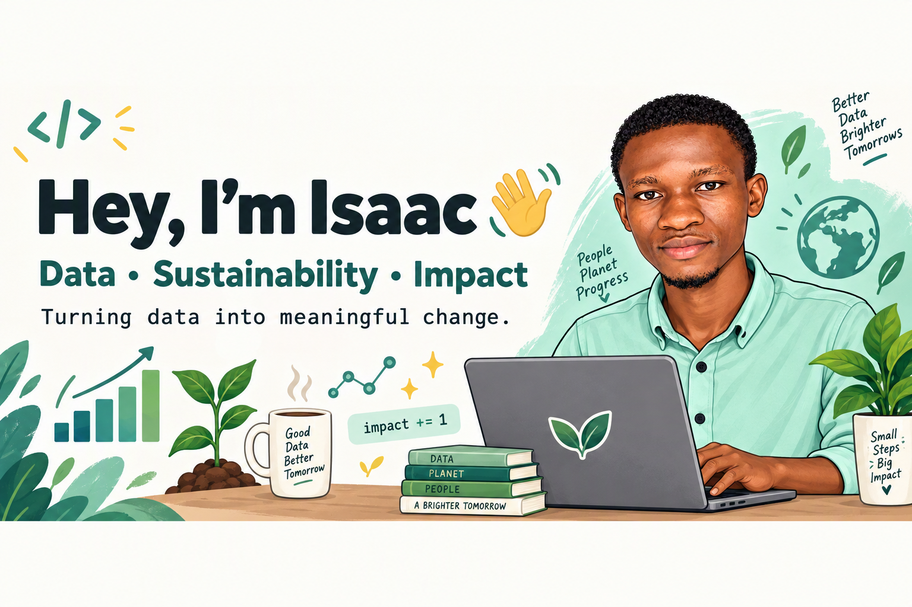

# Hi there, I'm Isaac Etungu! 👋

  

## About Me 🚀

I'm a **Data Scientist and Sustainability Data Analyst** passionate about leveraging data, technology, and analytics to solve real-world business and sustainability challenges.

With a background in **Financial Engineering, Agricultural Finance, and Data Analytics**, I enjoy building solutions that transform raw data into actionable insights and measurable impact.

- 🌱 Currently learning: AI, Machine Learning, Advanced Data Engineering and Automation.
- 🔭 Working on: Python-based data validation applications, sustainability analytics and automated reporting solutions.
- 🌍 Based in: Kampala, Uganda 🇺🇬
- 💻 Core interests: Data Science, Business Intelligence, Financial Analytics and Sustainability.
- 📊 Analytics stack: Python, SQL, Excel, Power BI and Streamlit.
- 📫 How to reach me: [LinkedIn](your_linkedin_url)
- ⚡ Fun fact: I believe data is only valuable when it drives decisions and creates impact!

---

## My Skills 🧠

**Programming & Data Analytics**

**Data Visualisation & Business Intelligence**

**Development & Tools**

**Areas of Expertise**

- Sustainability & Responsible Sourcing Analytics
- Data Quality Assurance & Validation
- Data Engineering & ETL Automation
- Financial Modelling & Credit Risk Analytics
- Monitoring, Evaluation & Learning (MEL)
- Agricultural & Development Finance

---

## Featured Projects 💻

### 1. IMPACT Progress Data Validator

**Technology:** Python | Streamlit | Pandas | Excel

An automated data validation application designed to improve the quality, consistency and reliability of sustainability survey data. It helps country teams identify data quality issues before analysis and reporting.

[View Repository](https://github.com/IsaacEtungu/IMPACT-Progress)

### 2. IMPACT Beyond Validation

**Technology:** Python | Streamlit | Pandas

A data quality management application designed to streamline sustainability data validation, standardisation and correction workflows, reducing manual review effort and improving reporting efficiency.

[View Application](https://impact-beyond-validation.streamlit.app/)

### 3. Sustainability Analytics & Business Intelligence

**Technology:** Power BI | Excel | Data Analytics

Developing interactive dashboards and analytical solutions to support sustainability performance monitoring, project reporting, funding analysis and evidence-based decision-making.

---

## Education & Professional Background 🎓

- MSc Financial Engineering
- BSc Agricultural Science & Entrepreneurship
- Data Analytics Certification
- ACCA Fellow – Credit Risk Management

---

## GitHub Statistics 📈

---

## Get in Touch 📬

- **GitHub:** [IsaacEtungu](https://github.com/IsaacEtungu)
- **LinkedIn:** [Connect with me](your_linkedin_url)

---

⭐ *Turning Data into Insights. Insights into Decisions. Decisions into Impact.*
